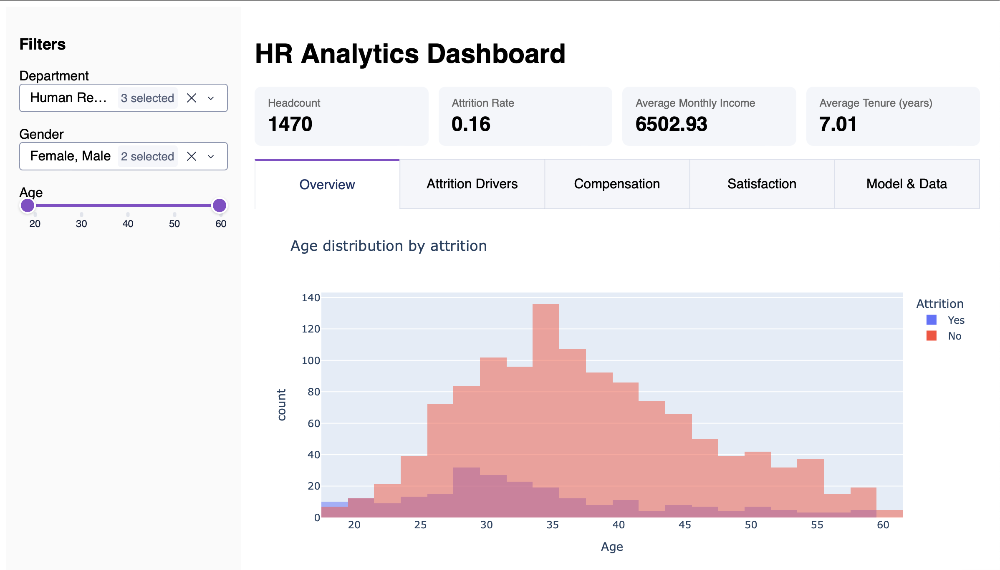
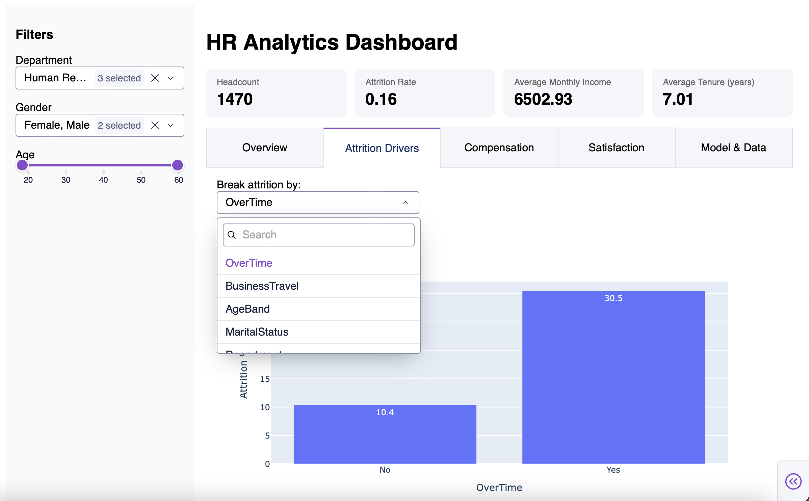
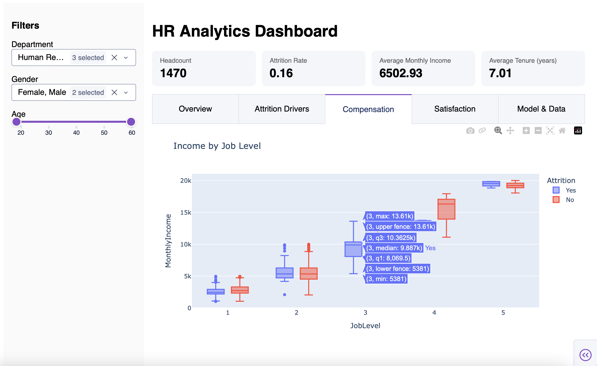
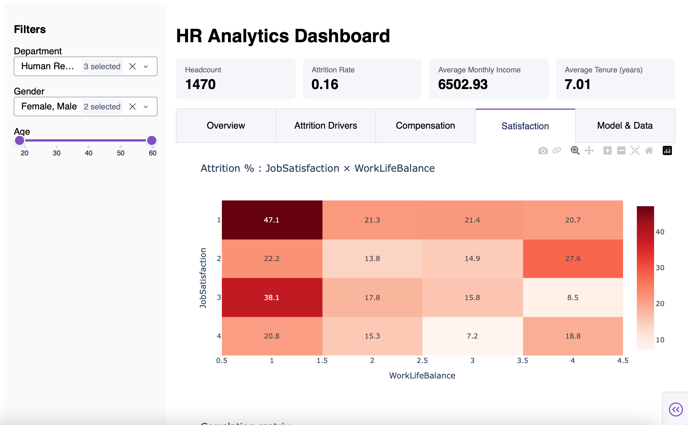
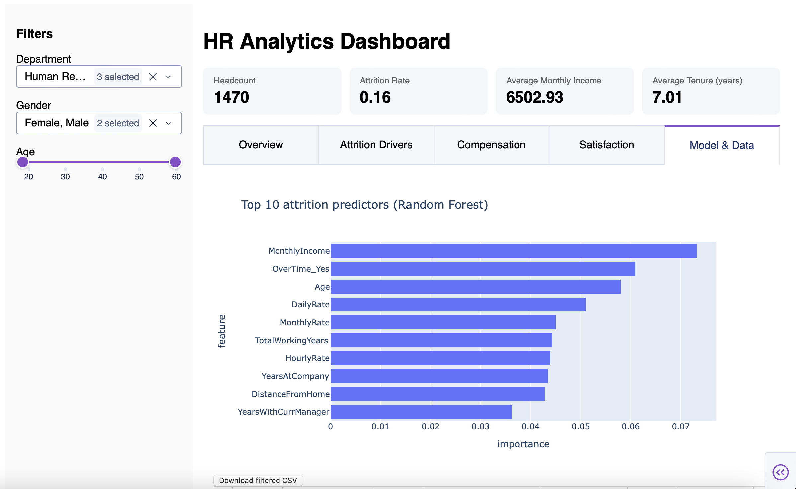

# HR Analytics Dashboard

An interactive HR Analytics Dashboard built with **Dash**, **Plotly**, **Pandas**, and **Scikit-learn** for exploring employee attrition, workforce demographics, compensation, and satisfaction trends.

The dashboard allows HR professionals to filter employees, visualize key metrics, identify attrition drivers, and explore a simple machine learning model that highlights the most important factors associated with employee turnover.

---

## Features

### Interactive Filters
- Department
- Gender
- Age range

All charts, KPIs, tables, and downloadable data update dynamically based on the selected filters.

---

## Dashboard Sections

### Overview
- Employee headcount
- Attrition rate
- Average monthly income
- Average tenure
- Age distribution
- Department distribution
- Attrition by job role



### Attrition Drivers
Analyze attrition across different dimensions including:
- Overtime
- Business Travel
- Age Group
- Marital Status
- Department
- Job Level
- Income Quartile
- Gender

The dashboard also generates a short insight highlighting the group with the highest attrition rate.



### Compensation
- Income by Job Level
- Income vs. Total Working Years
- Average income by gender



### Satisfaction
- Job Satisfaction × Work-Life Balance heatmap
- Correlation matrix of numerical variables



### Model & Data
- Random Forest feature importance
- Interactive employee table
- Download filtered dataset as CSV




---

## Machine Learning

A **Random Forest Classifier** is trained to predict employee attrition.

The dashboard displays the **Top 10 most important features** contributing to attrition, providing interpretable insights rather than predictive deployment.

---

## Technologies

- Python
- Dash
- Plotly
- Pandas
- Scikit-learn

---

## Dataset

IBM HR Analytics Employee Attrition & Performance Dataset

The dataset contains employee demographic, compensation, performance, and satisfaction information used for HR analytics and attrition analysis.

---

## Project Structure

```
HR-Analytics-Dashboard/
│
├── data/
│   └── IBM-HR-Analytics-Employee-Attrition-and-Performance.csv
|ــ asstets
│
├── app.py
├── requirements.txt
├── README.md
└── .gitignore
```

---

## Installation

```bash
git clone https://github.com/yourusername/hr-analytics-dashboard.git

cd hr-analytics-dashboard

pip install -r requirements.txt

python app.py
```

The application will be available at:

```
http://127.0.0.1:8050
```
---

## Author

**Maryam Zakeri**

GitHub: https://github.com/maryamzakeri-ds